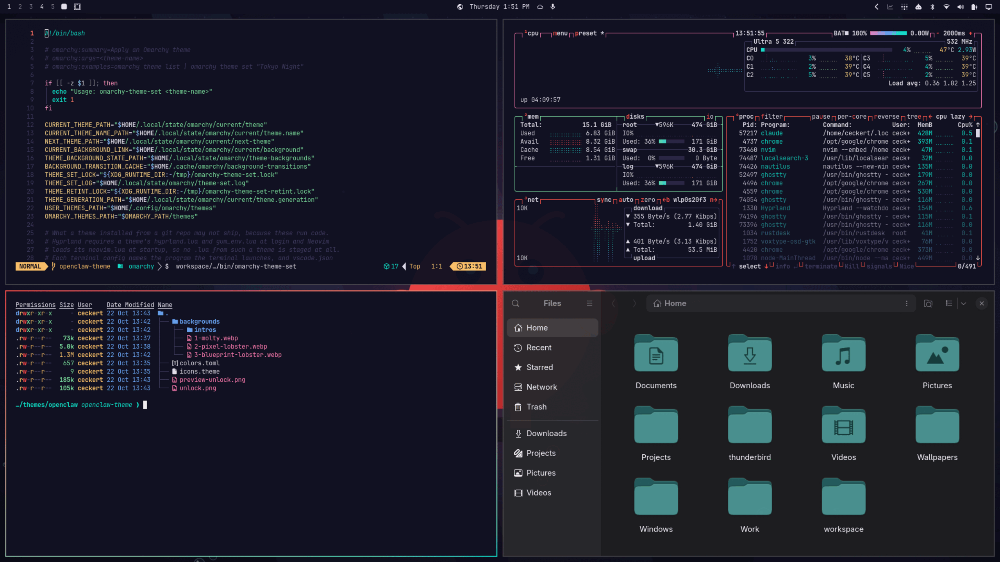
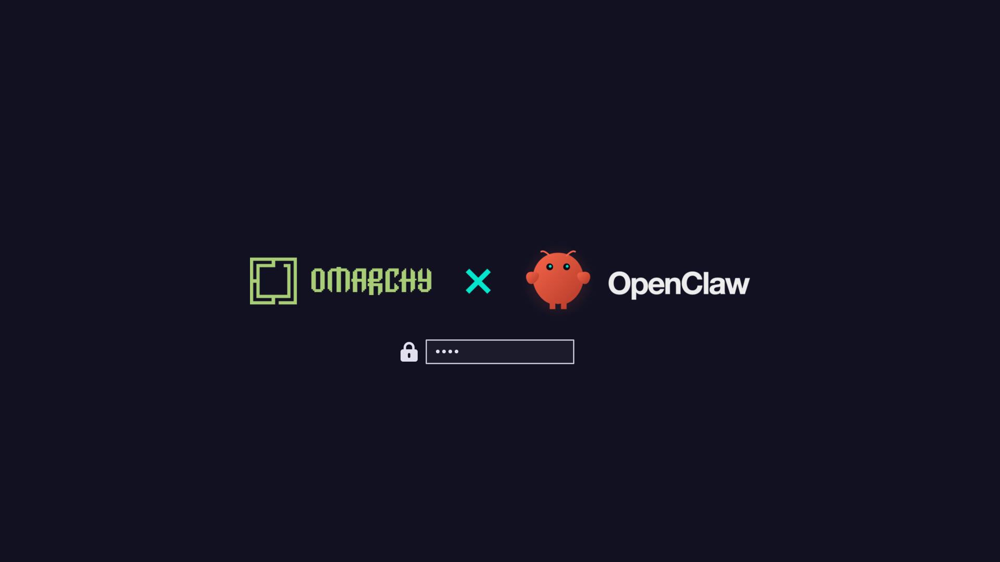

# OpenClaw for Omarchy

A thank-you from the OpenClaw community to the [Omarchy](https://omarchy.org) community: a dark Omarchy theme in OpenClaw's lobster coral and Molty teal, with two animated wallpapers and an Omarchy x OpenClaw boot screen.



## Install

```bash
omarchy theme install https://github.com/ceckert/omarchy-openclaw-theme
```

This clones the theme into `~/.config/omarchy/themes/openclaw` and switches to it. Run `omarchy theme update` later to pull new versions.

### Screensaver

Omarchy keeps the screensaver with your branding, not with the theme, so installing the theme leaves it alone. To use the OpenClaw screensaver, run the script that came with the theme (add `--preview` to start the screensaver straight away):

```bash
bash ~/.config/omarchy/themes/openclaw/screensaver.sh install
```

It backs up the screensaver you had first. The OpenClaw art stays after you switch to another theme, until you put yours back:

```bash
bash ~/.config/omarchy/themes/openclaw/screensaver.sh restore
```

### Boot screen

The Omarchy x OpenClaw logos go on the boot screen, where you type your disk password, with one command. It asks for your password and shows from the next boot:

```bash
omarchy plymouth set by theme openclaw
```

Switch back with `omarchy plymouth set by theme <your-theme>`, or `omarchy plymouth reset` for Omarchy's default.

### Remove

Switch to another theme first, then:

```bash
bash ~/.config/omarchy/themes/openclaw/screensaver.sh restore
omarchy theme remove openclaw
```

Found a problem or have an idea? [Open an issue](https://github.com/ceckert/omarchy-openclaw-theme/issues).

## What's inside

- **Palette:** navy backgrounds from the OpenClaw UI, lobster coral as the accent, Molty's teal as the second colour. Terminals, the bar, editors, btop and the browser are all coloured from `colors.toml`.
- **Window borders:** a coral-to-teal gradient.
- **Icons:** Yaru prussian green, a muted blue-green.
- **Boot screen:** the Omarchy and OpenClaw logos side by side, Omarchy's mark and wordmark x Molty and the OpenClaw wordmark. Install it with the [boot screen command](#boot-screen).
- **Screensaver:** OMARCHY x OpenClaw, OMARCHY in Omarchy's own lettering and OpenClaw in its wordmark's. Install it with the [screensaver script](#screensaver).
- **Wallpapers:** two, each with a six-second intro that plays at login and when you switch to the theme:
  - **Molty** (the default): Molty rises from the deep, lands with a squash, blinks, snaps both claws and sends up a teal heart.
  - **Blueprint lobster:** a coral scan line prints the etched lobster, and a sonar ping settles it.

Cycle the wallpapers from the Omarchy menu under Appearance > Background. Turn the intros on or off with `omarchy theme bg intro toggle`.



## Credits

The art comes from the [OpenClaw repository](https://github.com/openclaw/openclaw) and, for the Omarchy logo on the boot screen, from [Omarchy](https://github.com/omacom/omarchy):

| Theme file | Source |
|------------|--------|
| `backgrounds/1-molty.*` | `apps/linux/ui/mascot.svg`, animated with the float, wiggle, blink and snap timings of the openclaw.ai hero mascot |
| `unlock.png` | OpenClaw's `docs/assets/openclaw-hero-dark.png`, with Omarchy's mark (`U+E900` in `default/fonts/omarchy/omarchy.ttf`) and `logo.svg` (MIT, David Heinemeier Hansson) |
| `screensaver.txt` | Omarchy's `logo.txt`, and OpenClaw's wordmark from `docs/assets/openclaw-hero-dark.png` converted with `omarchy transcode ascii` |
| `backgrounds/2-blueprint-lobster.*` | `extensions/crabbox/assets/openclaw-worker-wallpaper.png`, debanded, upscaled and tinted |

The scripts that rebuild all of this art from the two projects are on the [`art-source`](https://github.com/ceckert/omarchy-openclaw-theme/tree/art-source) branch.

## License

MIT, see [LICENSE](LICENSE). The OpenClaw name and Molty are the OpenClaw Foundation's; the Omarchy name and wordmark are Omarchy's.
